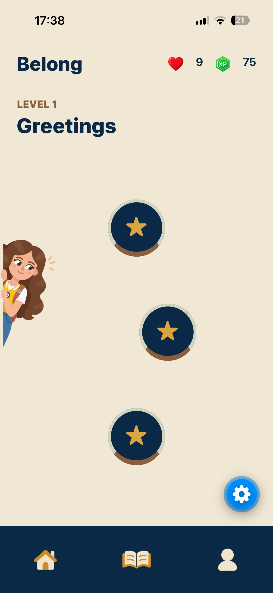
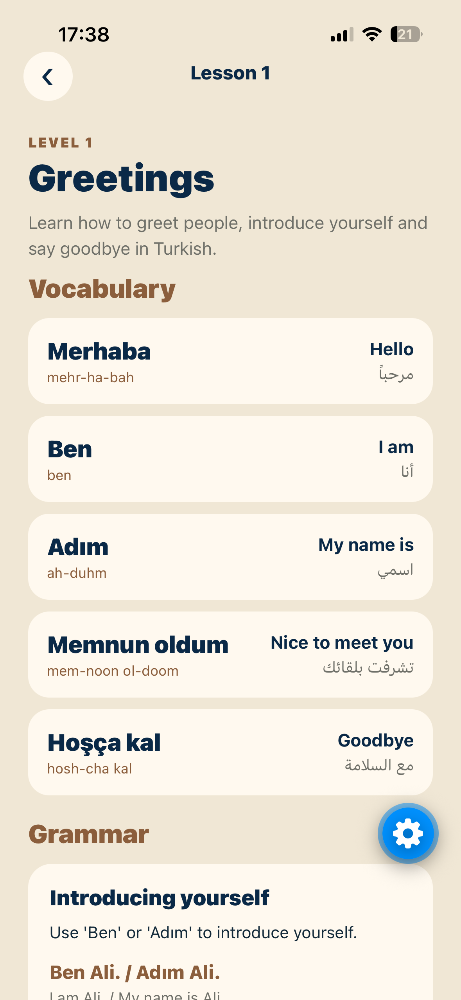
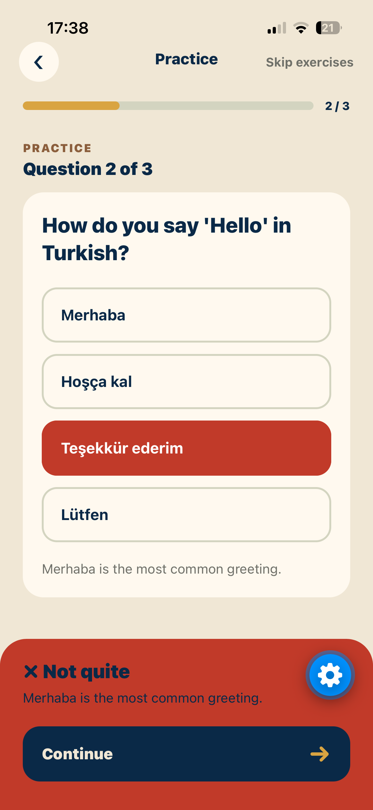
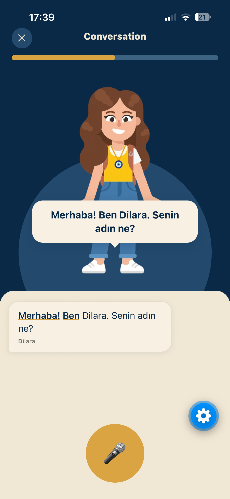
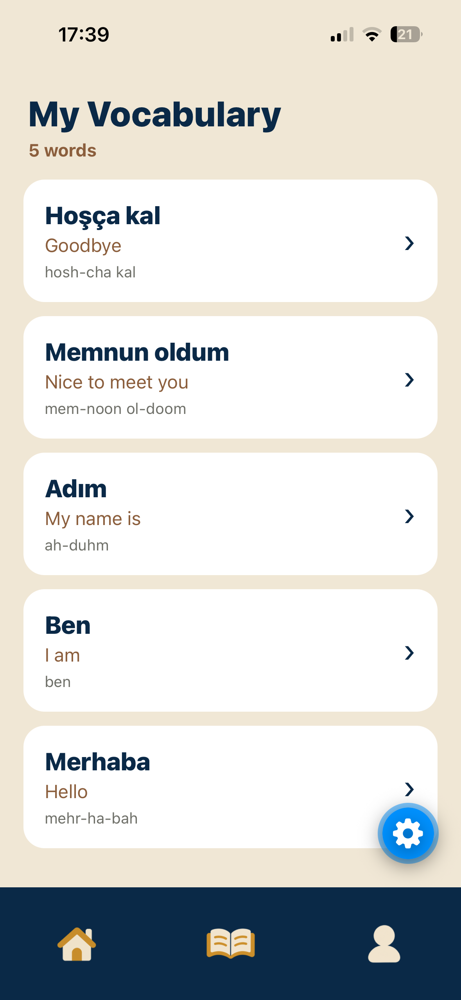

<p align="center">
  
</p>

<h1 align="center">Belong</h1>

<p align="center">
  An AI-powered language learning app that helps learners build Turkish fluency through structured lessons and AI conversations.
</p>

<p align="center">
  
  
  
  
</p>

---

## Overview

Belong is an AI-powered language learning project designed to help learners practise Turkish through a structured curriculum and interactive AI-character conversations. The mobile experience combines lesson content, vocabulary, grammar, exercises, and conversational practice in one learning flow.

The project uses a FastAPI backend with PostgreSQL and a React Native / Expo mobile frontend. The repository also contains a `frontend-web` directory; its current implementation details should be verified in that directory.

## App Screenshots

<p align="center">
  
  
  
</p>
<p align="center">
  
  
</p>

## Features

- **Structured lessons:** a shared learning path organized into levels and lessons.
- **Vocabulary and grammar:** lesson-related vocabulary and grammar content.
- **Interactive exercises:** practice activities that reinforce lesson material.
- **AI conversations:** practise through conversations with AI characters.
- **Progress and gamification:** user XP and hearts, with XP awarded for completing conversations and a bonus for completing without mistakes.
- **Vocabulary tracking:** save vocabulary learned by each authenticated user.
- **Character assets:** character illustrations are stored in `assets/characters`.

Feature details can evolve as development continues.

## Technology Stack

| Area | Technology |
|---|---|
| Mobile app | React Native, Expo, TypeScript |
| Backend API | Python, FastAPI, Uvicorn |
| Database | PostgreSQL 16 |
| ORM and database access | SQLAlchemy, Psycopg |
| Data validation and settings | Pydantic, Pydantic Settings |
| AI integration | Google GenAI SDK |
| Database migrations | Alembic |
| Local development | Docker Compose |

## Repository Structure

```text
Belong/
├── assets/
│   └── characters/             # Character artwork used by the app
├── backend/
│   ├── app/
│   │   ├── api/v1/              # Versioned API routes
│   │   ├── core/                # Configuration and shared core logic
│   │   ├── db/                  # Database setup and sessions
│   │   ├── dependencies/        # API dependencies, including authentication
│   │   ├── models/              # SQLAlchemy models
│   │   ├── repositories/        # Database queries and persistence
│   │   ├── schemas/             # Request and response schemas
│   │   ├── services/            # Application and business logic
│   │   └── main.py              # FastAPI application entry point
│   ├── data/lessons/            # Seed lesson content, where present
│   ├── scripts/                 # Development and seeding scripts
│   ├── alembic/                 # Database migration environment
│   ├── alembic.ini
│   ├── Dockerfile
│   └── requirements.txt
├── docs/
│   └── images/
│       ├── icon.png             # App icon used in this README
│       ├── homepage.png
│       ├── lesson.png
│       ├── exercise.png
│       ├── conversation.png
│       └── vocab.png
├── frontend-mobile/
│   ├── src/
│   │   ├── context/             # Shared state and authentication
│   │   ├── navigation/          # App navigation
│   │   ├── screens/             # Mobile screens
│   │   ├── services/            # API client and feature services
│   │   ├── theme/               # Shared visual design tokens
│   │   └── types/               # TypeScript types
│   └── package.json
├── frontend-web/                # Web frontend directory
├── docker-compose.yml
├── .gitignore
├── LICENSE
└── README.md
```

The tree is an architectural overview. Some nested files may differ from this outline; inspect the repository for the exact current file list.

## Architecture

The application is organized into three main parts:

1. **Mobile frontend** — renders lessons, exercises, vocabulary, conversations, and user progress.
2. **Backend API** — handles authentication, lesson and vocabulary data, conversation flow, and progress-related business logic.
3. **PostgreSQL database** — stores users and learning data. SQLAlchemy models and Alembic migrations define and evolve the schema.

The mobile app communicates with the backend over HTTP. Authenticated endpoints should receive the user's bearer token.

## Local Development

### Prerequisites

- Git
- Docker Desktop with Docker Compose
- Node.js and npm for mobile development
- Expo Go or an appropriate simulator/device
- Python is useful for running backend tooling outside Docker

### 1. Clone the repository

```bash
git clone https://github.com/danyaosman/Belong.git
cd Belong
```

### 2. Configure environment variables

Create a root `.env` file next to `docker-compose.yml`. Use the variable names required by your current backend settings and Compose configuration. At minimum, configure the backend port and any AI/API credentials required by the features you run.

Do not commit real API keys, passwords, or other secrets. The Compose configuration may provide database connection settings for local development; make sure the values in `.env`, `docker-compose.yml`, and backend settings agree.

### 3. Start the backend and database

```bash
docker compose up --build
```

The Compose setup uses PostgreSQL with host port `5433` mapped to container port `5432`, and maps the backend to the host port configured by `BACKEND_PORT`.

Once running, open the API documentation at:

```text
http://localhost:8000/docs
```

If you configure a different `BACKEND_PORT`, use that port in the URL instead.

### 4. Apply database migrations

Run Alembic from the backend directory. If running inside the backend container, the database hostname is typically `db`; when running tooling on your host, use the host-mapped database port and the matching local connection string.

```bash
cd backend
alembic upgrade head
```

If using Docker, you can instead run the equivalent Alembic command inside the backend container from the appropriate working directory.

### 5. Run the mobile app

```bash
cd frontend-mobile
npm install
npx expo start
```

Use Expo Go or a simulator/device supported by your development setup. Ensure the app's configured API base URL is reachable from that device. In particular, `localhost` on a physical phone refers to the phone itself, not your development computer.

## Development Notes

- **Database changes:** update the SQLAlchemy model, create and apply a migration, then update repository/service logic, schemas, API routes, frontend API functions and TypeScript types, and finally the relevant UI and tests.
- **Authentication:** use the authenticated user's ID from the backend dependency rather than hardcoding a user ID.
- **Progress:** XP and hearts are user progress values; verify the response and persisted database state when changing their logic.
- **Lesson completion:** if completion indicators are added to the home screen, they need a persisted completion source associated with the authenticated user.
- **Secrets:** keep `.env` out of version control and rotate any credentials that have accidentally been committed.

## Current Development Status

Belong is under active development. The repository includes a mobile client, FastAPI backend, database models and migrations, lesson content, and app artwork. APIs and frontend screens may continue to change.

## Contributing

For personal development or collaboration, use feature branches and focused commits. Before opening a pull request, verify that the backend starts, migrations apply, and the mobile app can reach the API.

## License

See the [`LICENSE`](LICENSE) file for the project's license.
